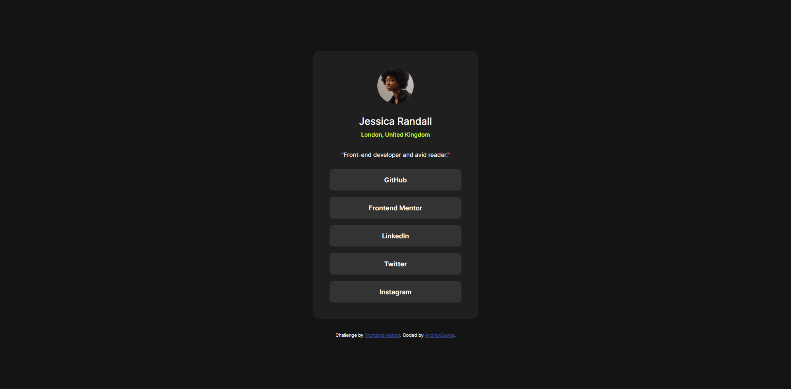
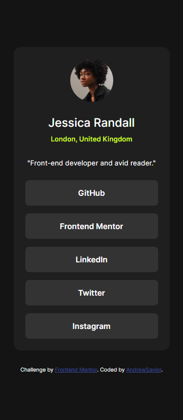
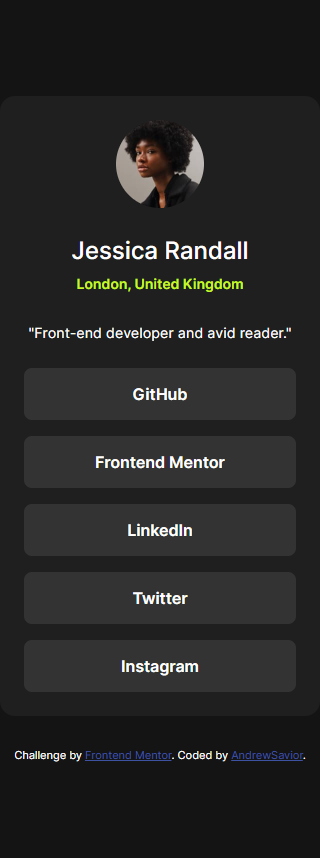

# Frontend Mentor - Social links profile solution

This is a solution to the [Social links profile challenge on Frontend Mentor](https://www.frontendmentor.io/challenges/social-links-profile-UG32l9m6dQ). Frontend Mentor challenges help you improve your coding skills by building realistic projects.

## Table of contents

- [Overview](#overview)
  - [The challenge](#the-challenge)
  - [Screenshot](#screenshot)
  - [Links](#links)
- [My process](#my-process)
  - [Built with](#built-with)
  - [What I learned](#what-i-learned)
  - [Continued development](#continued-development)
  - [Useful resources](#useful-resources)
  - [AI Collaboration](#ai-collaboration)
- [Author](#author)
- [Acknowledgments](#acknowledgments)

## Overview

### The challenge

Users should be able to:

- See hover and focus states for all interactive elements on the page

### Screenshot

1.Desktop version:

2.Desktop Hover active states:

3.Mobile version 375px:

4.Mobile version 320px:

For mobile **Hover** state was disabled.

### Links

- Solution URL: [Add solution URL here](https://hauvig.github.io/social_links_profile/)

## My process

### Built with

- Semantic HTML5 markup
- CSS custom properties
- Flexbox

### What I learned

In This challenge I remembered how to make the project more adaptive on mobile devices.

### Continued development

Start Learning JS and back-end.

### Useful resources

- [MDN](https://developer.mozilla.org) - This helped me remembered HTML and CSS.
- [Jonas Udemy Courses on HTML CSS](https://jonas.io/) - This is an amazing course which helped me finally understand and remember HTML and CSS. I'd recommend it to anyone who just started on HTML and CSS Journey.

### AI Collaboration

Describe how you used AI tools (if any) during this project. This helps demonstrate your ability to work effectively with AI assistants.

- What tools did you use (e.g., ChatGPT, Claude, GitHub Copilot)?
- For this challenge I used a little bit of Claude and ChatGPT to remember some things for mobile adaptive. I didn't use AI to complete this Challege, AI used only for remembering certain problem.
- How did you use them (e.g., debugging, generating boilerplate, brainstorming solutions)?
- Just asking about things, how this working or how i shoud do this or that etc.
- What worked well? What didn't?
- AI helped me to remember alot and gave me a lot of good examples how I can achive certain things for this challenge.

## Author

- Website - [AndrewSavior](https://github.com/HauviG)
- Frontend Mentor - [@HauviG](https://www.frontendmentor.io/profile/HauviG)
- Twitch - [@saviorisweeaboo](https://www.twitch.tv/saviorisweeaboo)

## Acknowledgments

This is where you can give a hat tip to anyone who helped you out on this project. Perhaps you worked in a team or got some inspiration from someone else's solution. This is the perfect place to give them some credit.

Thanks for the examle for this challenge from: @Donitron
GitHub: https://github.com/Donitron
I used his example to learn.
